👋 Hi, I’m Chris-Roland!

<h3 align="center">
  💜 Computer Science Student | Aspiring SOC Analyst
</h3>

  

<h3 align="center">🧑‍💻 About Me</h3>

* 🎓 I’m a Computer Science student specializing in Computer Networks and Telecommunications.
* 🌱 I’m currently learning programming and web development.
* 🛡️ I’m aiming for a career as a SOC analyst, focused on threat detection and network security.
* 🚀 I’m interested in building creative and useful web applications.
* 🧠 I’m curious, persistent and creative.
* 🏀 Outside coding, I enjoy basketball, video games and music.

<h3 align="center" style="color:#d9b8f0">🛠️ Languages & Technologies</h3>

  

<h3 align="center" style="color:#d9b8f0">🎯 My Interests</h3>

* 🛡️ Cybersecurity and threat detection
* 🌐 Web Development
* 🖥️ Computer Networks and traffic analysis
* 🗄️ Database Management
* 🚀 Learning new technologies

<h3 align="center" style="color:#d9b8f0">🚀 Projects</h3>

* 🌐 [Portfolio](https://chri5-007.github.io/PORTFOLIO/)

<h3 align="center" style="color:#d9b8f0">📊 GitHub Statistics</h3>

  
  

  

<h3 align="center" style="color:#d9b8f0">⚡ A Little More About Me</h3>

* 🎮 Gaming enthusiast
* 🏀 Basketball lover
* 🎧 Music is part of my daily routine
* 💡 Always curious, always learning.

  <b style="color:#f5c6dc">✨ "Consistency is the key to growth."</b>

  

